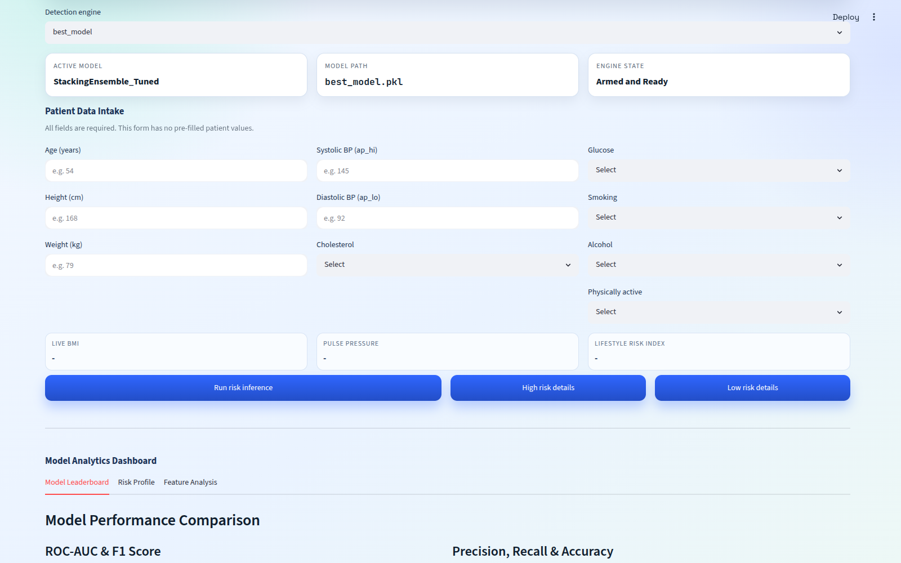

# Cardio Disease Detection Engine

Machine learning system that predicts cardiovascular disease risk (High / Low) from patient clinical and lifestyle data. Includes a Streamlit dashboard and a Flask API, both backed by a trained model ensemble.



## Features

- **Streamlit dashboard** (`streamlit_app.py`) — patient data intake form, live BMI / pulse pressure / lifestyle risk index, one-click risk inference, model leaderboard, risk profile and feature analysis views.
- **Flask API** (`flask_cardio_system.py`) — `/api/train` and `/api/predict` endpoints for programmatic access, plus a built-in web UI.
- **Training pipeline** (`cardio.py`) — data preprocessing, feature engineering, and model training.
- **Model zoo** (`Model/`) — Logistic Regression, Random Forest, Gradient Boosting, XGBoost, LightGBM, CatBoost, Voting Ensemble, Stacking Ensemble (tuned and untuned variants), with the best model auto-selected for production.

## Model Performance

| Model | Accuracy | Precision | Recall | F1 | ROC-AUC |
|---|---|---|---|---|---|
| StackingEnsemble_Tuned | 0.887 | 0.887 | 0.887 | 0.887 | 0.962 |
| XGBoost_Tuned | 0.885 | 0.887 | 0.882 | 0.885 | 0.960 |
| VotingEnsemble_Tuned | 0.866 | 0.880 | 0.849 | 0.864 | 0.948 |
| LightGBM_Tuned | 0.853 | 0.865 | 0.837 | 0.850 | 0.936 |
| CatBoost_Tuned | 0.804 | 0.811 | 0.793 | 0.802 | 0.883 |
| RandomForest | 0.777 | 0.798 | 0.742 | 0.769 | 0.851 |
| LogisticRegression | 0.719 | 0.703 | 0.758 | 0.730 | 0.788 |

Full breakdown in [MODEL_ANALYSIS_REPORT.md](MODEL_ANALYSIS_REPORT.md).

> **Note:** trained model artifacts (`Model/*.pkl`) exceed GitHub's file size limits and are excluded from this repo. Run `cardio.py` to retrain and regenerate them locally.

## Getting Started

```bash
python3 -m venv .venv
source .venv/bin/activate
pip install streamlit plotly pandas joblib scikit-learn xgboost lightgbm catboost flask

# Streamlit dashboard
streamlit run streamlit_app.py

# Flask API
python flask_cardio_system.py
```

## Project Structure

```
cardio.py                  # Training & feature engineering
streamlit_app.py           # Streamlit dashboard
flask_cardio_system.py     # Flask API + web UI
Model/                     # Trained model artifacts (.pkl) and metrics
MODEL_ANALYSIS_REPORT.md   # Detailed model analysis report
```

## License

MIT — see [LICENSE](LICENSE).

---

## Author

**Jeyadev R** · AI/ML Engineer & Full-Stack Developer · Chennai, India

- Portfolio: [jeyadev.dev](https://jeyadev.dev/projects/cardio-disease-detection-engine)
- GitHub: [@jeyadev-jd](https://github.com/jeyadev-jd)
- LinkedIn: [r-jeyadev](https://www.linkedin.com/in/r-jeyadev)

If this project is useful to you, a ⭐ on the repo helps others find it.
